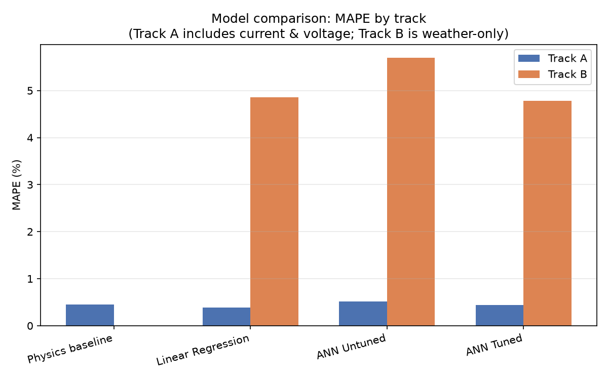
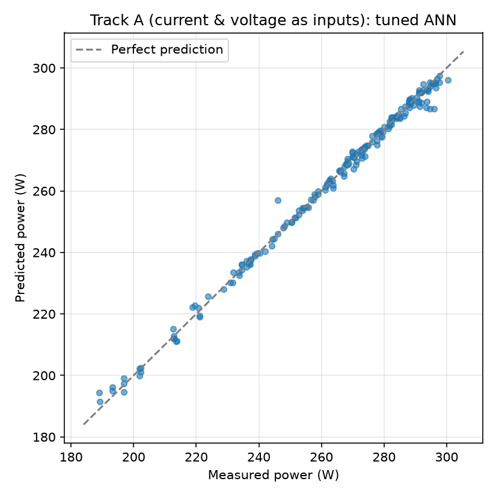
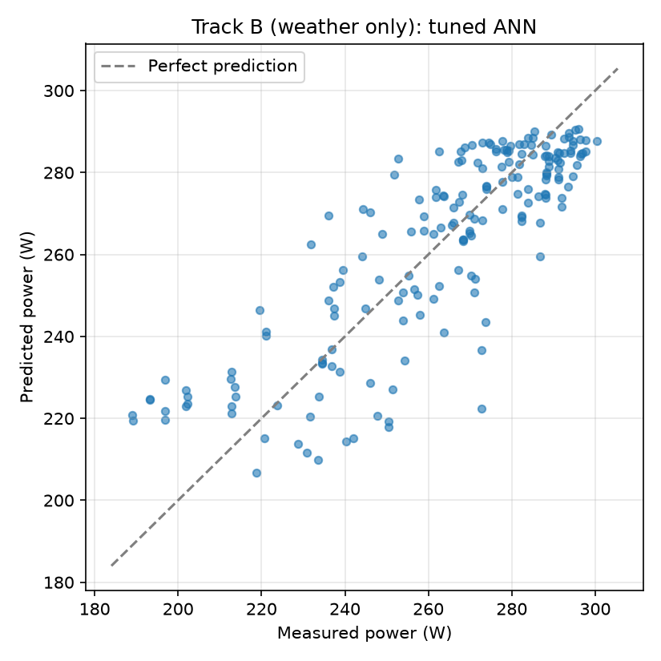
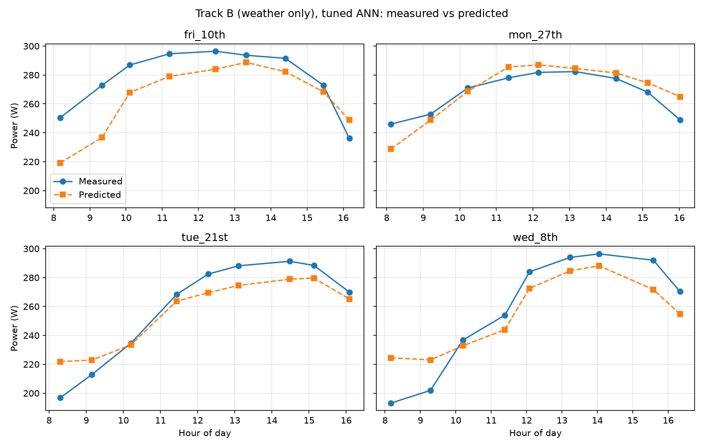
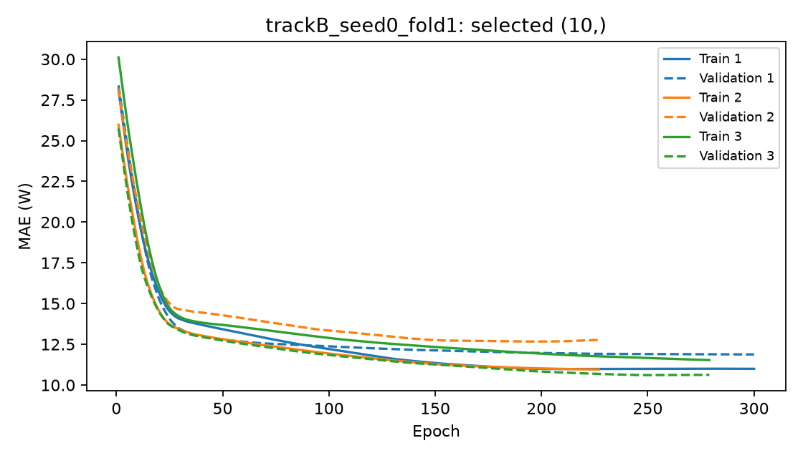

# Solar Power Forecasting: Python Reimplementation

A Python reimplementation and re-evaluation of an earlier MATLAB feedforward-ANN
project for solar power forecasting. The original MATLAB project is here:
[https://github.com/OluwafisayoIbrahim/ANN-Forecasting-for-Solar-Power].

## Background

The original project trained a feedforward Artificial Neural Network (ANN) in
MATLAB to forecast solar power output from environmental and electrical
measurements, reporting a Mean Absolute Percentage Error (MAPE) of 0.32%–0.60%.

Revisiting the project in Python surfaced a methodological issue with that
original evaluation (see **Key finding** below). This repository reimplements
the analysis with corrected, held-out validation, and reports what the ANN can
and cannot actually predict.

The project now also compares a TensorFlow/Keras ANN with the scikit-learn
models using the same held-out days. The completed comparisons include custom
architecture selection, early stopping, and saved training/validation curves.
The PyTorch extension implements the same small MLP protocol with an explicit
CPU training loop. Its full S2 research comparison is complete, with matching
protocol and reference-data checks against TensorFlow.

## Dataset

- 21 days of measurements, 9 readings per day (8am–4pm), 189 rows total
- Collected with pyranometers, solar panels and multimeters at Olabisi Onabanjo
  University
- Columns: `time, solar_irradiance, temperature, humidity, current, voltage, power`

Raw data: `data/raw/`. Combined, cleaned data: `data/processed/solar_data_combined.csv`,
produced by `src/load_data.py`.

## Key finding: Power ≈ Current × Voltage

`power` is almost exactly the product of `current` and `voltage` (that's simple
physics — P = IV). The original MATLAB model used current and voltage as ANN
*inputs* to predict power as the *output*. A model given both of those inputs
isn't really forecasting; it has a shortcut available that makes the problem
close to trivial. Consistent with this, a plain calculation of
`current × voltage` (no learning at all) reaches 0.45% MAPE on this data —
almost the same accuracy the original ANN reported.

This repository reports two tracks so the effect is visible directly.

## Track A vs. Track B

| Track | Inputs | Purpose |
|---|---|---|
| **A — replication** | irradiance, current, voltage, temperature, humidity | Matches the original MATLAB inputs. Included to show what the leakage does. |
| **B — weather only** | irradiance, temperature, humidity, hour of day | Predicts power from measured conditions without current and voltage; not a future-weather forecast. |

## Validation

With only 189 rows from 21 days, how the data is split matters a lot:

- **Grouped, by day:** all readings from a given day are kept together, in
  either training or testing, never split across both (`GroupKFold` on a
  `day_id`, 7 folds of 3 days each). This prevents same-day readings from
  leaking between train and test.
- **Nested tuning:** the scikit-learn ANN's hidden layer size and L2 regularization strength
  are chosen using only the training days in each fold (inner 3-fold grouped
  CV), never the held-out days. This keeps model selection honest.
- **Multiple seeds:** ANN results are averaged over 3 random initializations,
  since a network this small on this little data is sensitive to the seed.
- Metrics are computed on **pooled out-of-fold predictions** (every one of the
  189 rows predicted exactly once, while its day was held out), not averaged
  per fold, since per-fold R² on 3-day folds is unstable.

## Models compared

- **Physics baseline** (Track A only): `current × voltage`, no learning
- **Linear regression**
- **ANN, untuned**: 10 hidden units, `tanh` activation, `lbfgs` solver, L2
  `alpha=0.0001` — a practical approximation of the original MATLAB
  `fitnet(10)` (scikit-learn has no Levenberg-Marquardt solver, so `lbfgs`
  is used as the nearest available second-order alternative)
- **ANN, tuned**: hidden size (3 or 10) and L2 penalty (0.1, 1, 10) chosen
  by nested cross-validation
- **TensorFlow ANN, selected**: Keras network with a linear output, Adam
  optimizer and `tanh` hidden layers. Inner grouped CV selects either one
  10-unit hidden layer or two hidden layers of 16 and 8 units.
- **PyTorch ANN, selected**: the same architecture candidates, scaling and
  grouped selection protocol, implemented with an explicit CPU training loop.

## Results



The figure above shows the original scikit-learn/baseline comparison. The table
below includes the completed TensorFlow and PyTorch runs. Values are means over seeds
0, 1 and 2, with metrics calculated on pooled out-of-fold predictions per seed.

| Track | Model | MAE (W) | RMSE (W) | MAPE (%) | R² |
|---|---|---|---|---|---|
| A | Physics baseline | 1.168 | 1.321 | 0.445 | 0.998 |
| A | Linear Regression | 0.992 | 1.245 | 0.382 | 0.998 |
| A | ANN, untuned | 1.319 | 3.814 | 0.518 | 0.978 |
| A | ANN, tuned | 1.141 | 1.574 | 0.442 | 0.997 |
| A | TensorFlow ANN, selected (TF-A1000 below) | 1.237 | 1.811 | 0.471 | 0.996 |
| A | TensorFlow ANN, selected (S2) | 1.545 | 2.108 | 0.594 | 0.994 |
| A | PyTorch ANN, selected (S2) | 1.575 | 2.135 | 0.606 | 0.994 |
| B | Linear Regression | 12.165 | 15.149 | 4.854 | 0.701 |
| B | ANN, untuned | 14.302 | 23.980 | 5.698 | 0.191 |
| B | ANN, tuned | 11.965 | 15.089 | 4.786 | 0.703 |
| B | TensorFlow ANN, selected (TF-original below) | 12.015 | 14.979 | 4.797 | 0.707 |
| B | TensorFlow ANN, selected (S2) | 12.131 | 15.283 | 4.854 | 0.695 |
| B | PyTorch ANN, selected (S2) | 11.981 | 15.310 | 4.809 | 0.694 |

Run controls (historical TF rows are retained separately from the S2 comparison):

| Label / run directory | Cap | Learning rate | Batch | Tracks | Seeds |
|---|---|---|---|---|---|
| TF-original: `20261014T104851616874Z` | 300 | 0.001 | 32 | A, B | 0, 1, 2 |
| TF-A1000: `20261019T100248937256Z` | 1000 | 0.001 | 32 | A | 0, 1, 2 |
| S1: `results/tensorflow/convergence_s1` | 1000 | 0.01 | 32 | A, B | 0, 1, 2 |
| S2: `results/tensorflow/convergence_s2` | 1000 | 0.01 | 16 | A, B | 0, 1, 2 |
| PyTorch S2: `results/pytorch/parity_s2` | 1000 | 0.01 | 16 | A, B | 0, 1, 2 |

S1, S2 and the matching PyTorch S2 run are complete. S2 was selected by the
predeclared cap-count rule, not by outer-test scores. All settings use
patience 30, tanh, hidden candidates `(10,)` and `(16, 8)`, L2 0.0001,
seven outer folds and three inner folds. The earlier Track B result used
the **300-epoch cap**, not the later Track A budget.

Full comparisons, including standard deviations:
[matched S2 frameworks](results/comparisons/parity_s2/comparison.md),
[Track A, 1,000-epoch ceiling](results/tensorflow/20261019T100248937256Z/comparison.csv)
and [Track B](results/tensorflow/20261014T104851616874Z/comparison.csv).
The original baseline/scikit-learn table remains in
`results/metrics/model_comparison.csv`.

The TensorFlow runs used Python 3.13.1, TensorFlow 2.21.0 and scikit-learn
1.9.1. PyTorch S2 used the same Python and scikit-learn versions with CPU
PyTorch 2.9.1+cpu. Their configurations record the settings and versions. Standard
deviations describe variation across initialization seeds, not confidence
intervals for generalization.





## Discussion

Track A achieves near-perfect accuracy across every model, including the
no-learning physics baseline, because current and voltage make power almost
directly computable rather than forecastable. This confirms the leakage
described above and reproduces the original MATLAB project's low error
figures for the reasons given there.

Once current and voltage are excluded (Track B), errors rise substantially
and reflect the harder task of prediction from measured conditions. Here, model choice
matters: the untuned ANN — architecturally the closest match to the original
MATLAB network — is the worst performer on Track B (5.70% MAPE, R² 0.19),
consistent with overfitting the 162 training rows available in each outer fold. Once tuned
against that overfitting, the ANN (4.79% MAPE, R² 0.70) performs about the
same as plain linear regression (4.85% MAPE, R² 0.70). On a dataset this
size, there is no evidence that a neural network offers a meaningful
advantage over a simpler model, and the lightly regularized untuned ANN performs
measurably worse.

On Track B, TensorFlow has slightly lower RMSE (14.979 W) and higher R²
(0.707) than the tuned scikit-learn ANN, but slightly higher MAE (12.015 W)
and MAPE (4.797%). These small differences do not establish a meaningful
advantage on 21 measurement days. Raising Track A's training ceiling from 300
to 1,000 epochs reduced TensorFlow MAPE from 0.715% to 0.471%, but linear
regression remained better at 0.382%. Adding TensorFlow provides more training
controls and learning curves, but does not automatically improve accuracy.
Linear regression's strong Track A result is consistent with power being
almost determined by current and voltage over this dataset's observed range.
The product is bilinear mathematically; these results do not prove linear
regression is always best outside that range.

Under the matched S2 protocol, TensorFlow and PyTorch give similar results.
Track A MAE is 1.545 W and 1.575 W respectively; Track B MAE is 12.131 W
and 11.981 W. The differences are small relative to seed variation and do not
establish a general framework advantage. Linear regression remains best on
Track A, while tuned scikit-learn has the lowest mean MAE on Track B.
Removing cap hits did not guarantee better outer-test scores: the historical
TensorFlow runs above have lower mean errors than S2 on several metrics.
S2 is retained because its choice rule used inner evidence, not those scores.

This compares training approaches, not just frameworks: TensorFlow uses Adam
and standardized targets, while scikit-learn uses L-BFGS and unscaled targets.
Keras L2 and scikit-learn alpha are not numerically equivalent penalties.

## TensorFlow training and learning curves

Each outer fold holds out three complete days. Within its remaining training
days, three inner grouped folds select the architecture by mean validation MAE.
Early stopping monitors inner validation MAE with patience 30 and restores the
best weights. The selected architecture is then rebuilt on all outer training
days for the median best epoch count from the inner folds. Outer test days
never select the architecture or training duration.

Defaults are 300 maximum epochs, batch size 32, learning rate 0.001 and hidden
kernel L2 of 0.0001. Track A was rerun with a 1,000-epoch ceiling after every
one of its original 21 selected refits chose epoch 300. Input and target
scalers are fitted only on the training portion of each fit. Predictions are
converted back to watts before evaluation.

Example learning curves for Track B, seed 0, outer fold 1:



Solid lines show training MAE; dashed lines show inner validation MAE, both in
watts. These curves describe the selected candidate's inner fits, not outer-test
performance or the final refit. Epoch CSVs also contain raw loss in standardized
target units, including regularization; that loss is not MSE in watts squared.

Every run creates a new `results/tensorflow/<UTC timestamp>/` directory:

| Output | Contents |
|---|---|
| `comparison.csv` | Mean and population standard deviation of pooled metrics over seeds |
| `metrics_per_seed.csv` | Metrics for each track, model and seed |
| `predictions.csv` | Held-out predictions with row, source day and fold identifiers |
| `selected_settings.csv` | Chosen settings, refit epoch counts and final sklearn fit convergence-warning counts |
| `config.json` | Run controls and Python/model-library versions |
| `learning_curves/` | PNG curves and per-epoch CSVs for selected candidates' inner fits |

The completed Track A run emitted scikit-learn L-BFGS convergence warnings
during inner tuning. Among the 21 final outer fits, 13 untuned and 14 tuned
fits also reached the 5,000-iteration limit. Completion does not mean every
fit converged. Inner tuning warnings appear in the terminal; the counts in
`selected_settings.csv` cover final sklearn fits only.

The daily profile plots show the tuned Track B model tracking the general
shape of a day's power curve reasonably well, but with real, visible
deviation in magnitude on some days (see `fri_10th`, `fri_17th` in particular).

## Limitations

- 189 samples is a small dataset for any neural network; results should be
  read as indicative, not as a robust generalization claim.
- Weather features here are simple instantaneous readings (irradiance,
  temperature, humidity, hour); no lagged or forecasted weather variables
  were available.
- Grouped CV evaluates held-out days, not a chronological forecast into the
  future. The TensorFlow addition does not change that distinction.
- Architecture is selected inside CV, but other TensorFlow controls are fixed
  in advance. Repeatedly adjusting them based on outer results would bias evaluation.
- Each inner validation fold supplies both the early-stopping epoch and the
  score used to select the architecture. This can make inner selection mildly
  optimistic, but the untouched outer test days keep the reported scores fair.
- The historical TF-A1000 Track A run remained training-limited: 18 of 21 selected refits
  chose epoch 1,000, and 50 of 63 selected inner histories had their best
  validation MAE at the final epoch. Its 0.471% MAPE should therefore be read
  as the result under a 1,000-epoch budget, not a fully converged optimum.
  The newer S2 runs have no selected refits at the cap in either framework
  or track, but this is not proof of an optimal fit.
- The untuned Track B ANN is unstable across seeds (R2 standard deviation
  0.463) and produced convergence warnings. Its exact score may be sensitive
  to platform and numerical libraries. A different Linux result was reported
  during review, but its run CSVs are absent, so it is not included as verified
  numerical evidence. The committed run ranks it worst on Track B.
- Cap-hitting indicates possible undertraining; fewer than 20% of selected
  epochs at the cap is a screening rule, not a proof of convergence.
- Matching architectures, Glorot initialization, Adam epsilon, float32 and
  batch policy does not match random draws or numerical operations across
  frameworks. Adam's epsilon placement also differs between Keras and
  PyTorch implementations, even when both use 1e-7.
- Grouped-by-day validation and a random row-based split give fairly similar
  results on this dataset, suggesting same-day leakage is not the dominant
  source of the original inflated numbers — the current/voltage leakage is.

## Repository structure

```
solar-power-prediction-python/
|-- .github/workflows/              # automated Python tests
|-- data/                            # raw and processed measurements
|-- deployment/                      # Streamlit app and deployment helpers
|-- notebooks/                       # exploratory analysis
|-- results/
|   |-- figures/                     # comparison plots
|   |-- metrics/                     # saved metrics
|   |-- models/                      # deployable sklearn and TensorFlow models
|   |-- predictions/                 # pooled out-of-fold predictions
|   |-- tensorflow/                  # historical and completed S1/S2 comparisons
|   |-- pytorch/                     # completed S2 PyTorch comparison
|   |-- comparisons/                 # matched framework comparison reports
|   `-- smoke/                       # ignored integration runs
|-- src/
|   |-- baselines.py                 # baseline CV, using validation.py
|   |-- validation.py                # shared grouped-validation helpers
|   |-- predict.py                   # sklearn inference
|   |-- predict_tf.py                # TensorFlow inference and scaling
|   |-- train_final_model.py         # final sklearn model export
|   |-- train_final_tf.py            # final TensorFlow model export
|   |-- export_baseline_models.py    # linear and untuned model exports
|   |-- load_data.py                 # load, clean and combine
|   |-- features.py                  # Track A/B inputs and day groups
|   |-- evaluate.py                  # shared regression metrics
|   |-- models.py                    # sklearn ANN
|   |-- models_tf.py                 # Keras ANN
|   |-- models_torch.py              # PyTorch nn.Module and hidden-kernel L2
|   |-- train_ann.py                 # sklearn grouped nested CV
|   |-- train_ann_tf.py              # TF fits and shared comparison protocol
|   |-- train_ann_torch.py           # explicit CPU training loop
|   |-- train_final_torch.py         # final checkpoint and scaler export
|   |-- predict_torch.py             # trusted checkpoint inference
|   |-- check_convergence.py         # selected-epoch diagnostics
|   |-- compare_frameworks.py        # protocol checks and comparison reports
|   |-- train_baselines.py           # physics and linear evaluation
|   |-- save_results.py              # original metric reports
|   |-- save_predictions.py          # original prediction reports
|   `-- plots.py                     # original comparison figures
|-- tests/                            # unit and Streamlit integration tests
|-- requirements.txt                 # pinned research environment
`-- README.md
```

## How to run

From the project root on Windows, install the pinned research dependencies
(including TensorFlow 2.21.0) into the project virtual environment:

```powershell
.\.venv\Scripts\python.exe -m pip install -r requirements.txt
.\.venv\Scripts\python.exe src/load_data.py
```

Run the original baseline/scikit-learn reports and plots:

```powershell
.\.venv\Scripts\python.exe src/save_results.py
.\.venv\Scripts\python.exe src/save_predictions.py
.\.venv\Scripts\python.exe src/plots.py
```

Run the full TensorFlow comparison:

```powershell
.\.venv\Scripts\python.exe src/train_ann_tf.py
```

Defaults require 294 TensorFlow fits across both tracks, three seeds and seven
outer folds, plus the scikit-learn fits. Training can take a long time. Progress
prints once per outer fold; per-epoch terminal output is disabled. Existing
reports are preserved in their original locations.

For an integration check or a smaller exploratory run:

```powershell
.\.venv\Scripts\python.exe src/train_ann_tf.py --smoke-test
.\.venv\Scripts\python.exe src/train_ann_tf.py --tracks B --seeds 0 --architectures 10 --epochs 100
```

The smoke test uses two epochs, two outer folds and one seed on Track B. Its
scores are not research results; sklearn inner tuning still runs.
Default smoke outputs go to ignored `results/smoke/<framework>/<timestamp>/`.
The old committed smoke run was moved there; genuine historical runs remain
in `results/tensorflow/`.

Customize candidate architectures and training controls:

```powershell
.\.venv\Scripts\python.exe src/train_ann_tf.py --architectures 10 16,8 32,16 --activation relu --epochs 500 --patience 40 --learning-rate 0.001 --batch-size 16 --l2 0.001
.\.venv\Scripts\python.exe src/train_ann_tf.py --help
```

Spaces separate candidate architectures; commas separate hidden layers within
one candidate. Use `--output PATH` for a named run directory that does not yet
exist. The original `src/plots.py` generates the original comparison figures;
TensorFlow learning curves are generated by `src/train_ann_tf.py` itself.

## Saving a final TensorFlow model

The comparison saves evaluation outputs, not deployable network weights. To
refit and save a final Track B model using the completed comparison's settings:

```powershell
.\.venv\Scripts\python.exe src/train_final_tf.py
```

The default source run is `results/tensorflow/20261014T104851616874Z`.
It supplied the historical Track B model. Recreate the historical Track A model
from its 1,000-epoch comparison with:

```powershell
.\.venv\Scripts\python.exe src/train_final_tf.py --track A --run results/tensorflow/20261019T100248937256Z --output PATH_TO_EMPTY_DIRECTORY
```

Use `--run PATH` for another completed run and `--track A` for Track A.
The final architecture is the most frequent inner-selected architecture across
all seeds and folds (ties use candidate order). Its median selected epoch count
sets the final training duration. This is a deployment heuristic using existing
tuning decisions, not a new search or selection by outer test accuracy. A fresh
network with seed 0 is fitted on all observations; the published nested-CV
metrics remain the evaluation of the original training procedure, not an
independent test of this particular final model.

The script writes `track_b_ann_final.keras`, `track_b_x_scaler.joblib`,
`track_b_y_scaler.joblib`, and `track_b_tf_metadata.json` into `results/models`.
The metadata records feature order, settings, source run and library versions.
Both scalers must accompany the network. Existing files are never overwritten;
use `--output PATH` for a new export. The existing scikit-learn models are unchanged.
After saving, the script reloads the files and checks that predictions match
the in-memory model on every training row. This verifies serialization, not accuracy.

For inference, import `load_tf_model` and `predict_measurements` from
`src/predict_tf.py` (or `predict_tf` when `src` is on the Python import path).
Load once, then pass a DataFrame with named feature columns; the helper orders
inputs, applies input scaling, and converts outputs back to watts. Only load
trusted model/scaler files. The `.gitignore` exceptions allow both tracks'
scalers to be included with the networks for deployment.

## Convergence reruns and PyTorch parity

The root `requirements.txt` includes pinned CPU PyTorch 2.9.1+cpu from
the [official CPU wheel index](https://pytorch.org/get-started/previous-versions/),
alongside the research and local test dependencies.
No separate PyTorch requirements file is needed. `deployment/requirements.txt`
delegates to the root file so deployment and CI install the same pinned packages.
The Streamlit registry now uses the S2 TensorFlow and PyTorch exports.
Unittest discovery finds `test_torch.py`, which skips cleanly when torch is
absent; the complete app test suite requires the root dependencies.

### Predeclared choice rule

Run both S1 and S2 below with the same tracks, seeds, architectures and folds.
Use only `selected_settings.csv` and inner learning curves to choose:

1. Prefer the setting with fewer selected epochs at the cap, summed across
   both tracks (42 selections per completed candidate).
2. Break a cap-count tie with lower mean `inner_mae` in watts over those
   selections, giving the two tracks equal weight.
3. Break an exact tie with S1. Use the chosen setting for both tracks and
   both frameworks, even if an outer metric happens to favor the other.

Report each track separately as passing the cap screen only if fewer than
20% of its selections hit the cap. If neither setting passes for both tracks,
keep the same rule's winner and label the affected results capped/possibly
undertrained. Inspect inner curves as diagnostics, but do not repeatedly
change the rule after inspecting outer scores. This development study has
already inspected historical outer scores; a fresh independent dataset would
be needed to confirm the final choice.

```powershell
.\.venv\Scripts\python.exe src/train_ann_tf.py --tracks A B --seeds 0 1 2 --epochs 1000 --learning-rate 0.01 --batch-size 32 --patience 30 --output results/tensorflow/convergence_s1
.\.venv\Scripts\python.exe src/train_ann_tf.py --tracks A B --seeds 0 1 2 --epochs 1000 --learning-rate 0.01 --batch-size 16 --patience 30 --output results/tensorflow/convergence_s2
.\.venv\Scripts\python.exe src/check_convergence.py results/tensorflow/convergence_s1
.\.venv\Scripts\python.exe src/check_convergence.py results/tensorflow/convergence_s2
```

Historical diagnostic commands:

```powershell
.\.venv\Scripts\python.exe src/check_convergence.py results/tensorflow/20261014T104851616874Z
.\.venv\Scripts\python.exe src/check_convergence.py results/tensorflow/20261019T100248937256Z
```

The checker uses no outer metrics. It reports per-track cap counts, min/median/max
selected epochs, architecture votes and mean inner MAE. In the original run,
Track A has 21/21 at cap 300, while B has 2/21 (median 237). The later A run has
18/21 at cap 1000 (min 410, median/max 1000). These are median selected refit
epochs, not counts of individual inner fits that invoked early stopping.

Phase 1 outcome: **S2 selected**. S1 has one cap hit across both tracks;
S2 has none, so no tie-break is needed. Both candidates pass the <20% screen
on each track. The choice does not imply S2 has the lowest outer-test error.

| Candidate | Cap hits A / B | Mean inner MAE A (W) | Mean inner MAE B (W) |
|---|---|---|---|
| S1 | 1/21 / 0/21 | 1.222466 | 11.203077 |
| S2 | 0/21 / 0/21 | 1.319234 | 11.194881 |

### PyTorch training loop

`TorchANN` registers Linear layers with tanh and a final linear scalar output.
All kernels use Glorot uniform and all biases start at zero. Like `models_tf.py`,
L2 covers **hidden kernels only**, excluding the output kernel and every bias.
The training loop uses MSE on standardized targets plus explicit L2,
`Adam(eps=1e-7, weight_decay=0)`, and a seeded DataLoader that reshuffles each
epoch and retains partial batches. CPU execution uses one thread and deterministic
algorithms. Validation runs with `eval()` and `no_grad()`; a deep-copied best
state is restored after early stopping on scaled validation MAE.
The [Keras Adam documentation](https://keras.io/api/optimizers/adam/) identifies
its epsilon as "epsilon hat"; equal epsilon values alone do not make its
updates numerically identical to PyTorch Adam.

The same shared functions perform inner grouped selection, median-epoch
refitting, outer GroupKFold splits, sklearn baseline fits, watt metrics and
CSV/PNG reporting for TensorFlow and PyTorch. The sklearn tuning helper
retains its existing three inner folds, including in smoke runs. Learning-curve
CSVs cover each inner fold of the selected architecture; PNGs overlay those
curves per outer fold, matching TensorFlow's existing format.

After choosing S1 or S2 by the rule above, set `$chosen` accordingly. The
command reads all training controls from that TF run to avoid accidental
framework differences:

```powershell
$chosen = "s2"  # Selected by the predeclared inner-evidence rule.
$tfRun = "results/tensorflow/convergence_$chosen"
$ptRun = "results/pytorch/parity_$chosen"
$config = Get-Content "$tfRun/config.json" -Raw | ConvertFrom-Json
$architectures = @($config.architectures | ForEach-Object { $_ -join "," })
.\.venv\Scripts\python.exe src/train_ann_torch.py --tracks $config.tracks --seeds $config.seeds --architectures $architectures --activation $config.activation --epochs $config.epochs --learning-rate $config.learning_rate --batch-size $config.batch_size --patience $config.patience --l2 $config.l2 --folds $config.folds --inner-folds $config.inner_folds --output $ptRun
.\.venv\Scripts\python.exe src/check_convergence.py $ptRun
.\.venv\Scripts\python.exe src/compare_frameworks.py --tf-run $tfRun --torch-run $ptRun --output "results/comparisons/parity_$chosen"
```

Outputs include a merged CSV, Markdown table and protocol JSON. Means and
population standard deviations are recalculated from per-seed metrics.
Mismatched settings, input data/outer splits or smoke runs produce a prominent
warning in the terminal and outputs. Shared baselines are collapsed only when
their recorded metrics agree; otherwise both sources are retained.

The completed comparison is in
[results/comparisons/parity_s2](results/comparisons/parity_s2/comparison.md).
Its protocol and reference-data checks match, with no warnings and matching
baseline metrics. Existing run/report directories must not be reused for reruns.

Under S2, Track A MAE is 1.545 +/- 0.162 W for TensorFlow and
1.575 +/- 0.071 W for PyTorch. Track B MAE is 12.131 +/- 0.379 W and
11.981 +/- 0.132 W respectively. These are means and population standard
deviations over three seeds, not confidence intervals; there is no established
general framework winner. Both tracks in both frameworks have 0/21 selections
at the 1,000-epoch cap. PyTorch selected epochs have min/median/max of
71/126/207 on A and 3/16/82 on B; TensorFlow has 68/179/431 and 3/15/41.

### Final exports and tests

Use fresh output directories. Neither exporter overwrites existing artifacts
or accepts a smoke run. The PyTorch exporter votes over the chosen architecture,
takes that architecture's median epoch, fits all rows with seed 0, and verifies
save/reload predictions. Its four files are a `.pt` state dictionary, x/y
scalers and metadata (including dataset hash, versions and epoch cap).
`predict_torch.py` loads the checkpoint with `weights_only=True`; scaler files
must still come from a trusted source. Streamlit now loads the S2 PyTorch
exports alongside the S2 TensorFlow models.

After setting the variables above:

```powershell
.\.venv\Scripts\python.exe src/train_final_tf.py --track A --run $tfRun --output "results/exports/tf_$chosen"
.\.venv\Scripts\python.exe src/train_final_tf.py --track B --run $tfRun --output "results/exports/tf_$chosen"
.\.venv\Scripts\python.exe src/train_final_torch.py --track A --run $ptRun --output "results/exports/torch_$chosen"
.\.venv\Scripts\python.exe src/train_final_torch.py --track B --run $ptRun --output "results/exports/torch_$chosen"
.\.venv\Scripts\python.exe -m unittest discover -s tests -v
.\.venv\Scripts\python.exe src/train_ann_tf.py --smoke-test
.\.venv\Scripts\python.exe src/train_ann_torch.py --smoke-test
```

Both exporters check serialization on training rows; that is not independent
accuracy validation. PyTorch tests cover deterministic fits, loss reduction,
early stopping, scaler isolation, initialization, L2 scope, grouped selection,
checkpoint round trips and overwrite/smoke rejection.

### Verification on 2026-10-20

- `python -m unittest discover -s tests -v`: 25 tests passed in the project
  Python 3.13.1 environment with TensorFlow 2.21.0 and CPU PyTorch 2.9.1+cpu.
- A separate simulated torch-absent discovery skipped all eight PyTorch tests.
- `python src/train_ann_tf.py --smoke-test` passed. Its per-seed metrics
  exactly matched the archived historical smoke CSV after the shared-runner refactor.
- `python src/train_ann_torch.py --smoke-test` passed.
- `compare_frameworks.py` processed those two smoke runs, confirmed matching
  baseline metrics and wrote the required smoke warning into the reports.
- `python -m pip check` and `git diff HEAD --check` passed.

Local ignored outputs are under `results/smoke/tensorflow/20261020T110728939146Z`,
`results/smoke/pytorch/20261020T111033503176Z`, and
`results/smoke/framework_comparison_20261020`.
Smoke scores are intentionally absent from the research results table.
The final PyTorch exporter was exercised on a 32-row synthetic unit-test
dataset, including save/reload, metadata hash, and refusal to overwrite.
At that verification date, full S1/S2 experiments, the full PyTorch comparison
and new full-data exports had not yet been run.

### Research completion on 2026-10-21

The user completed TensorFlow S1/S2, PyTorch S2 and the matched comparison.
The saved comparison reports no protocol/reference-data warnings. The PyTorch
convergence checker was rerun successfully: 0/21 cap hits on each track.
Research results above now reflect these completed runs. All four full-data
S2 exports are complete in `results/exports/tf_s2` and
`results/exports/torch_s2`, with networks, input/target scalers and metadata.
All use hidden layers `(16, 8)` and seed 0. TensorFlow uses 167 epochs for A
and 5 for B; PyTorch uses 124 for A and 16 for B, selected by the documented
architecture-vote and median-epoch rule.

Each exported bundle was reloaded successfully, its recorded training-data
hash matched the current dataset, and it produced 189 finite predictions.
These checks verify artifact usability, not independent predictive accuracy.
The local Streamlit registry now loads these S2 bundles without overwriting
the historical files in `results/models`. PyTorch is available for single and
spreadsheet predictions, diagrams, and upload training with downloadable
session bundles. Hosted deployment still requires a commit/push and redeploy.

Integration verification: all 27 tests passed, including all eleven saved
predictors, PNG diagrams, PyTorch upload training, isolated holdout scaling,
download/reload prediction equality, and UI model/mode changes. `pip check`
and the deployment requirements include check passed. The local Streamlit
health endpoint returned `ok`. Browser visual inspection was unavailable;
UI behavior was exercised with Streamlit's AppTest API.

Historical `check_convergence.py` output, summarized from the saved CSVs:

| Run | Track | Selections at cap | Epoch min/median/max | Votes `(10,)` / `(16,8)` | Mean inner MAE (W) | Screen |
|---|---|---|---|---|---|---|
| `20261014T104851616874Z` | A | 21/21 at 300 | 300/300/300 | 9 / 12 | 1.990002 | NOT converged |
| `20261014T104851616874Z` | B | 2/21 at 300 | 35/237/300 | 8 / 13 | 11.327374 | passes <20% screen |
| `20261019T100248937256Z` | A | 18/21 at 1000 | 410/1000/1000 | 6 / 15 | 1.473606 | NOT converged |

## Interactive prediction app

The app now includes six sidebar views: Research Overview, Dataset Explorer,
Experiments & Results, Prediction Workspace, Model Explorer, and Research
Methodology & Limitations. Research charts load saved experiment artifacts;
historical and matched-framework results have separate views. See
[dashboard documentation](deployment/README.md) for data provenance and controls.

`deployment/app.py` includes a selector for all eleven current comparison predictors
and two explicitly labelled historical TensorFlow models (13 saved predictors),
single-reading predictions, CSV/Excel (`.xlsx`) batch uploads, prediction graphs,
measured-power comparisons, CSV downloads, and downloadable model diagrams.
Choose saved-model inference or train a fresh session model from uploaded
measurements with a `power` target. Session training uses a separate holdout
and can export its model without overwriting the project artifacts.

```powershell
.\.venv\Scripts\python.exe -m pip install -r requirements.txt
.\.venv\Scripts\python.exe -m streamlit run deployment/app.py
```

Track B uploads require `solar_irradiance`, `temperature`, `humidity`, and `hour`.
Track A replaces hour with `current` and `voltage`; physics needs only those
two electrical inputs. Forms and templates adapt to the selected model.
An optional full `timestamp` supports multi-day graphs; optional measured
`power` enables error metrics and measured-versus-predicted plots. Invalid rows
are retained with an explanation and no prediction. Prediction uploads do not
retrain the model; training is a separate explicit action. See
[deployment instructions](deployment/README.md) for limits, units,
output columns, timestamp handling and Streamlit hosting files.

## Relationship to the original project

This project corrects and extends an earlier undergraduate MATLAB project. The original repository has been updated with a
note pointing to this correction. The original SSRN preprint has also been
revised accordingly: [https://papers.ssrn.com/sol3/papers.cfm?abstract_id=4771898].
